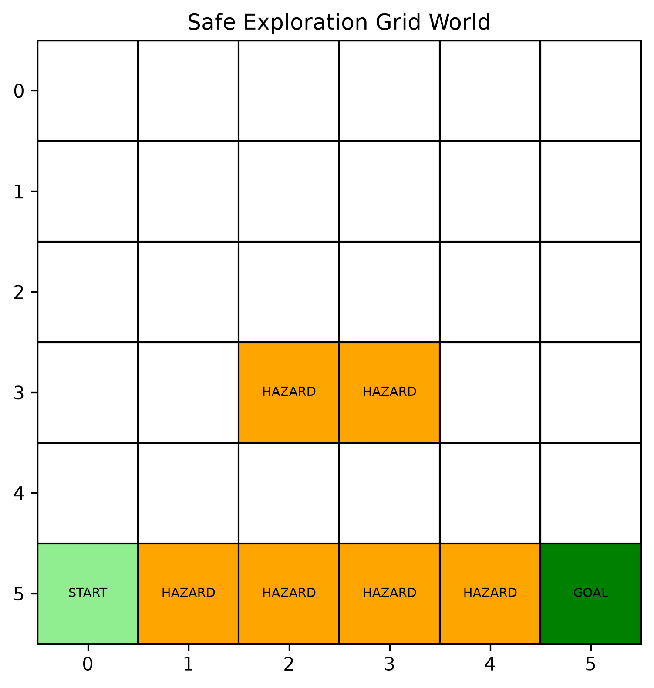
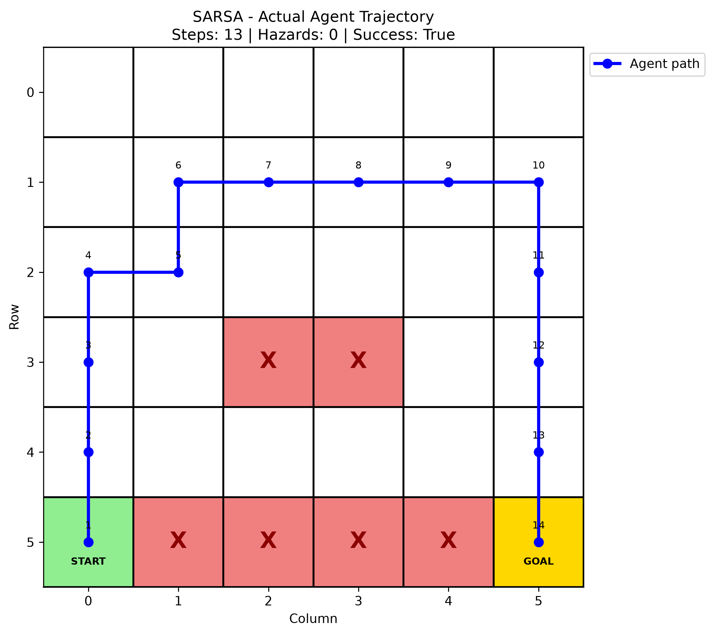
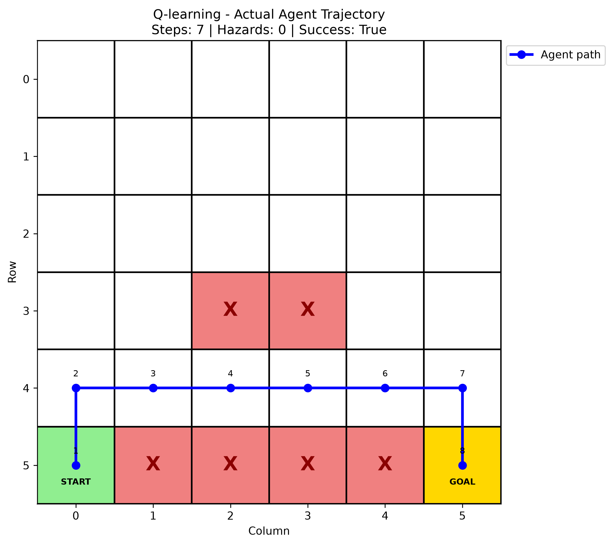

# Safe Exploration in Reinforcement Learning: SARSA vs. Q-Learning

A comparative study of **SARSA and Q-learning** in a grid-world environment with hazardous states. This project explores how two temporal-difference reinforcement learning algorithms learn policies, navigate around hazards, and balance reward maximization with safer exploration.

## Project Overview

Reinforcement learning agents learn by interacting with an environment and receiving rewards or penalties. However, an agent may encounter hazardous states while learning.

This project implements and compares two model-free reinforcement learning algorithms:

- **SARSA (On-policy TD Control):** Learns using the action actually selected by the current behavior policy.
- **Q-learning (Off-policy TD Control):** Learns using the maximum estimated action value at the next state.

The main objective is to study how their different update rules influence learning behavior and the paths taken by the trained agents.

## 1. Environment: Grid World

The environment is a 6 × 6 grid containing:

- A starting position.
- A goal state.
- Hazardous cells, including a cliff-like region.
- Ordinary traversable cells.

The agent can take four actions: Up, Down, Left, and Right.

### Environment Visualization

<p>
  
</p>


### Reward Structure

| Event | Reward | Behavior |
|---|---:|---|
| Ordinary move | -1 | Continue |
| Enter hazard | -20 | Reset to start; episode continues |
| Reach goal | +20 | Episode terminates |
| Hit grid boundary | -1 | Remain in current cell |

The negative reward for hazardous states encourages the agent to learn routes that avoid dangerous regions.

## 2. Algorithms

### SARSA

SARSA is an on-policy temporal-difference learning algorithm.

Its update rule is:


$$Q(S_t,A_t) \leftarrow Q(S_t,A_t) +
\alpha \left[
R_{t+1}+\gamma Q(S_{t+1},A_{t+1})-Q(S_t,A_t)
\right]$$


It uses the next action actually selected by the behavior policy.

### Q-Learning

Q-learning is an off-policy temporal-difference learning algorithm.

Its update rule is:

$$
Q(S_t,A_t) \leftarrow Q(S_t,A_t) +
\alpha \left[
R_{t+1}+\gamma \max_a Q(S_{t+1},a)-Q(S_t,A_t)
\right]
$$

It uses the maximum estimated action value at the next state, regardless of which action the behavior policy selects.

### Key Difference

SARSA learns from the policy it follows, whereas Q-learning learns toward a greedy target policy. This difference can influence how the algorithms behave during exploration.

## 3. Actual Agent Trajectories

After training, both agents are evaluated using greedy action selection to visualize the routes learned by their respective Q-tables.

### SARSA: Learned Trajectory

<p>
  
</p>

### Q-Learning: Learned Trajectory

<p>
  
</p>

These visualizations show the sequence of states visited by each agent, including hazard encounters and resets when applicable.

## 4. Project Structure

```text
Safe_Exploration_RL/
│
├── safe_exploration.ipynb
├── README.md
│
├── src/
│   ├── __init__.py
│   ├── environment.py
│   ├── algorithms.py
│   ├── training.py
│   └── evaluation.py
│
└── results/
    ├── grid_world_environment.png
    ├── sarsa__actual_agent_trajectory.png
    └── qlearning__actual_agent_trajectory.png
```

| File | Description |
|---|---|
| `environment.py` | Defines the grid world, states, actions, rewards, transitions, and visualization. |
| `algorithms.py` | Implements epsilon-greedy action selection and SARSA/Q-learning updates. |
| `training.py` | Contains the training loops for both algorithms. |
| `evaluation.py` | Evaluates trained agents and generates performance and trajectory visualizations. |
| `safe_exploration.ipynb` | Runs experiments, trains agents, and compares results. |
| `results/` | Stores generated plots and visualizations. |

## 5. Getting Started

### Requirements

- Python 3.10 or later
- NumPy
- Matplotlib
- Jupyter Notebook
- IPython Kernel

### Installation

Clone the repository:

```bash
git clone https://github.com/shwetambari-mali/safe-exploration-sarsa-qlearning.git

cd safe-exploration-sarsa-qlearning
```

Create and activate a virtual environment:

```bash
python3 -m venv .venv

# macOS / Linux
source .venv/bin/activate
```

Install dependencies:

```bash
python -m pip install numpy matplotlib jupyter ipykernel
```

### Running the Project

Open the project folder in VS Code:

```bash
code .
```

Open `safe_exploration.ipynb`, select the `.venv` Python kernel, and execute the notebook cells in order.

## 6. Evaluation and Comparison

The project can compare the algorithms using:

- **Cumulative episode reward:** Total reward received during an episode.
- **Episode length:** Number of steps taken before termination or the step limit.
- **Hazard encounters:** Number of times the agent enters a hazardous state.
- **Success rate:** Percentage of evaluation episodes reaching the goal.
- **Learned trajectories:** Routes followed by the trained agents.

These metrics help examine the trade-offs between learning performance, route efficiency, and hazard avoidance.

## 7. Limitations and Future Work

This project uses a small, discrete grid-world environment and tabular reinforcement learning.

Potential extensions include:

- Compare performance across multiple random seeds.
- Study the impact of exploration rate (\(\epsilon\)), learning rate (\(\alpha\)), and discount factor (\(\gamma\)).
- Investigate how different hazard penalties affect learned policies.
- Introduce more complex environments and dynamic hazards.
- Explore constrained reinforcement learning and explicit safety mechanisms.

**Note:** Avoiding hazards in this particular environment does not constitute a formal safety guarantee. The project studies empirical behavior under a specified reward structure.

## Technologies Used

Python | NumPy | Matplotlib | Jupyter Notebook | Reinforcement Learning